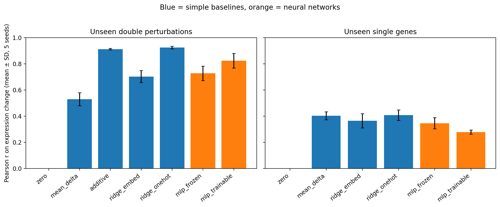
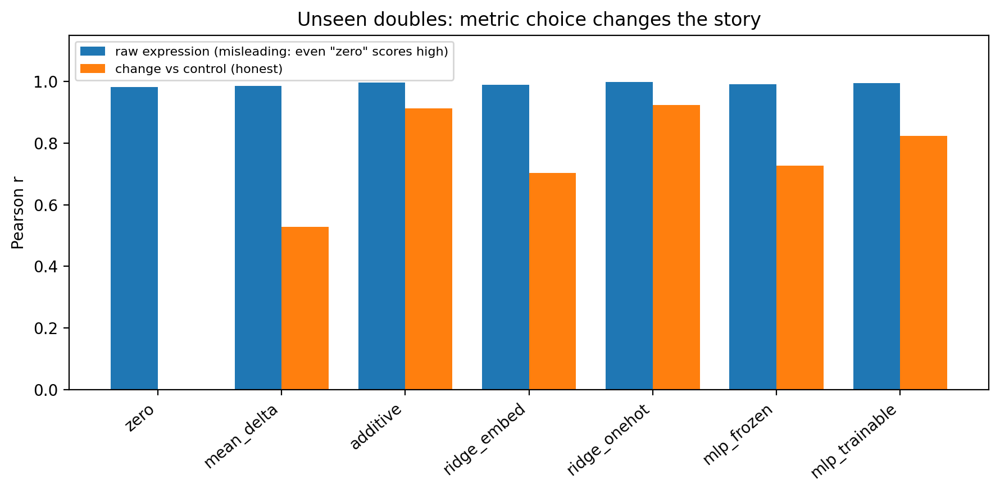
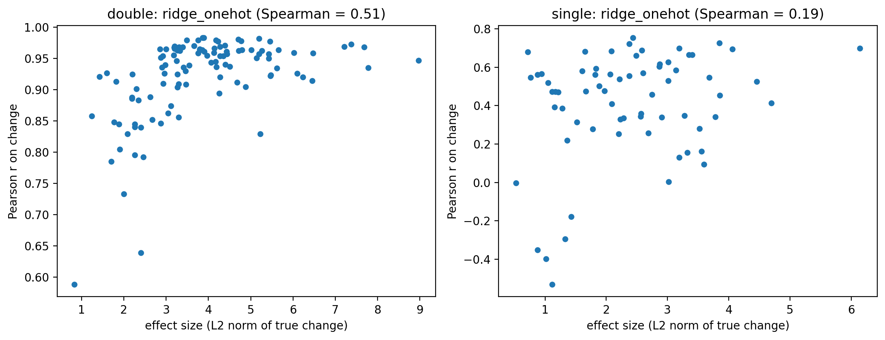

import os
WORK = globals().get('WORK', '/content/perturb-benchmark')
os.makedirs(WORK, exist_ok=True)

README = r'''# Do deep models beat linear baselines at predicting unseen CRISPR perturbation responses?

A small, leakage-aware benchmark on the Norman et al. (2019) Perturb-seq dataset. It asks whether neural networks predict the transcriptional effect of **unseen** genetic perturbations better than simple linear and additive baselines.

**Short answer in this setting:** no. Ridge regression and a plain additive model beat lightly tuned MLPs on unseen double perturbations, and no model clearly beats the average effect on unseen single genes.

## Key findings

1. **Unseen double perturbations.** Ridge regression on one-hot perturbation features (Pearson Δ = 0.923) and the additive model (0.912) beat both MLPs (0.727 frozen embeddings, 0.823 trainable embeddings). Neither MLP beat the best baseline in any of the 5 seeds.
2. **Unseen single genes are hard for every model.** Scores range from 0.28 to 0.41. The mean-effect baseline already reaches 0.403, and ridge on one-hot features (0.408) is essentially the same because an unseen gene gives it no signal. Embeddings built from control cells did not help (0.364).
3. **Raw-expression correlation is misleading.** Even a model that predicts "no change" (`zero`) gets a Pearson correlation of 0.98 or higher on raw expression. All reported conclusions therefore use the correlation of the *change* relative to control.
4. **Trainable embeddings helped on doubles (0.823 vs 0.727) but hurt on unseen singles (0.278 vs 0.345).** A plausible explanation, not tested here, is that training moves the embeddings of genes seen in training while an unseen gene keeps its initial embedding, so the two no longer match.

> TODO: add one sentence from the MLP sensitivity check (`results/mlp_sensitivity_double.csv`), e.g. "Across 4 training configurations the MLP stayed below X."

## Data

- **Source:** Norman et al., 2019, K562 cells, CRISPRa Perturb-seq, obtained via the scPerturb collection (file `NormanWeissman2019_filtered.h5ad`, hosted on Zenodo).
- **Raw size:** 111,445 cells x 33,694 genes.
- **After filtering:** 102 single and 129 double perturbations, plus control. Perturbations with fewer than 30 cells were dropped, as were perturbations targeting genes missing from the expression matrix (105 targeted genes in the raw file, 102 retained).
- The raw data file is not stored in this repository (see `data/README.md`).

## Method

**Preprocessing.** Counts were normalized to 10,000 per cell and log1p-transformed. Cells were capped at 400 per perturbation and 4,000 for control, for speed and memory. The gene set is the 2,000 most variable genes plus the perturbed genes (2,064 genes). Each perturbation is summarized as a **pseudo-bulk** profile (mean expression over its cells).

**Target.** For each perturbation, delta = pseudo-bulk expression minus control pseudo-bulk expression.

**Splits (5 random seeds each).**
- *Unseen doubles:* 30% of doubles are held out. Every gene in a held-out double still appears as a single perturbation in training.
- *Unseen singles:* 20% of single genes are held out completely. Training excludes any perturbation containing a held-out gene.

**Models.**

| Model | Description |
|---|---|
| `zero` | Predicts no change |
| `mean_delta` | Average training delta |
| `additive` | Double = sum of its two single-gene deltas (doubles only) |
| `ridge_onehot` | Ridge regression on which genes were perturbed |
| `ridge_embed` | Ridge on a 32-dim gene embedding (PCA of control cells only, so no perturbation information leaks in) |
| `mlp_frozen` | MLP on summed gene embeddings, embeddings fixed |
| `mlp_trainable` | Same MLP, embeddings initialized identically but trainable |

The MLP predicts the average training delta plus a learned correction. It is trained full-batch with AdamW and early stopping on 10% of the training perturbations. Ridge penalties are chosen by cross-validation on training data only.

**Metrics** (computed per held-out perturbation, then averaged):
- *Pearson Δ:* correlation between predicted and true change over all genes.
- *Pearson Δ (top 20):* the same, restricted to the 20 genes with the largest true change (a common convention, but it uses the true effect to choose genes).
- *MSE (top 20):* mean squared error on those genes.
- *Pearson Δ excluding the targeted gene(s):* guards against a model scoring well only by predicting the targeted gene itself.
- *Pearson on raw expression:* reported only to demonstrate how inflated it is.

## Results

Mean ± SD over 5 seeds. Best value per column in each table is **bold**.

### Unseen double perturbations

| Model | Pearson Δ | Pearson Δ (top 20) | MSE (top 20) |
|---|---|---|---|
| zero | 0.000 ± 0.000 | 0.000 ± 0.000 | 0.485 |
| mean_delta | 0.528 ± 0.050 | 0.543 ± 0.073 | 0.358 |
| additive | 0.912 ± 0.006 | 0.957 ± 0.002 | 0.053 |
| ridge_embed | 0.702 ± 0.046 | 0.750 ± 0.070 | 0.243 |
| ridge_onehot | **0.923 ± 0.010** | **0.963 ± 0.005** | **0.039** |
| mlp_frozen | 0.727 ± 0.055 | 0.768 ± 0.081 | 0.215 |
| mlp_trainable | 0.823 ± 0.055 | 0.874 ± 0.056 | 0.130 |

### Unseen single genes

| Model | Pearson Δ | Pearson Δ (top 20) | MSE (top 20) |
|---|---|---|---|
| zero | 0.000 ± 0.000 | 0.000 ± 0.000 | 0.215 |
| mean_delta | 0.403 ± 0.031 | 0.463 ± 0.061 | **0.165** |
| ridge_embed | 0.364 ± 0.055 | 0.403 ± 0.073 | 0.196 |
| ridge_onehot | **0.408 ± 0.040** | **0.473 ± 0.059** | 0.185 |
| mlp_frozen | 0.345 ± 0.042 | 0.401 ± 0.056 | 0.209 |
| mlp_trainable | 0.278 ± 0.017 | 0.315 ± 0.041 | 0.237 |

(`additive` cannot predict an unseen single gene.)

### Figures





## Error analysis

- Perturbations with the weakest true effects are hardest to predict (Figure 3; tables in `results/hardest_double.csv` and `results/hardest_single.csv`).
- Genes with the largest prediction error are listed in `results/gene_error_double_ridge_onehot.csv`.

- **Top-20 genes are chosen from the true effect,** following common practice..

## Limitations

- **Pseudo-bulk only.** Single-cell heterogeneity is not modeled.
- **One cell line (K562)** and one perturbation technology (CRISPRa).
- **The MLPs are lightly tuned.** See the sensitivity analysis in `results/mlp_sensitivity_double.csv`. This is not an exhaustive search.
- **Small sample.** Roughly 190 training perturbations for doubles and 170 for singles.
- **Top-20 genes are chosen from the true effect,** following common practice, which favors flexible models slightly less than a fixed gene set would.
- **Highly variable genes were selected using all cells,** including cells later used for testing (label-free, but not strictly isolated).
- **Embeddings come from control-cell PCA only.** Richer gene representations (pathways, protein interaction networks, pretrained models) were not tested.
- **Not compared with published perturbation-prediction models.** These results do not say anything about them.

## Future work

- Compare against published perturbation-prediction models under the same splits.
- Test richer gene embeddings for the unseen-gene case, where every model stalled near 0.40.
- Move to cell-level modeling, where GPU compute would matter.

## Reproducing this project

Everything runs on a free Google Colab **CPU** runtime (a few minutes in total).

1. Run `notebooks/day1_preprocess.ipynb` (download, filtering, pseudo-bulk).
2. Run `notebooks/day2_baselines.ipynb` (splits, baselines, metrics).
3. Run `notebooks/day3_mlp.ipynb` (MLP models).
4. Run `notebooks/day4_analysis.ipynb` (figures, error analysis).

```bash
pip install -r requirements.txt
```

## Repository structure

├── README.md
├── requirements.txt
├── notebooks/ # Day 1-4 Colab notebooks
├── results/ # per-perturbation results, summaries, sensitivity analysis
├── figures/ # Figures 1-3
└── data/ # split definitions and gene lists (raw data not included)


## References

- Norman, T. M. et al. Exploring genetic interaction manifolds constructed from rich single-cell phenotypes. *Science* 365, 786-793 (2019).
- Peidli, S. et al. scPerturb: harmonized single-cell perturbation data. *Nature Methods* (2024). doi:10.1038/s41592-023-02144-y
- Ahlmann-Eltze, C., Huber, W., Anders, S. Deep-learning-based gene perturbation effect prediction does not yet outperform simple linear baselines. *Nature Methods* 22, 1657-1661 (2025). doi:10.1038/s41592-025-02772-6. Closely related work that benchmarked foundation models and GEARS against simple baselines. This project asks a similar question at small scale, on one dataset, with simple MLPs.

## Author

GitHub: [tehreemraouf-06](https://github.com/tehreemraouf-06)
'''

with open(f'{WORK}/README.md', 'w', encoding='utf-8') as f:
    f.write(README)
print("README.md written to", WORK, "|", len(README.splitlines()), "lines")
